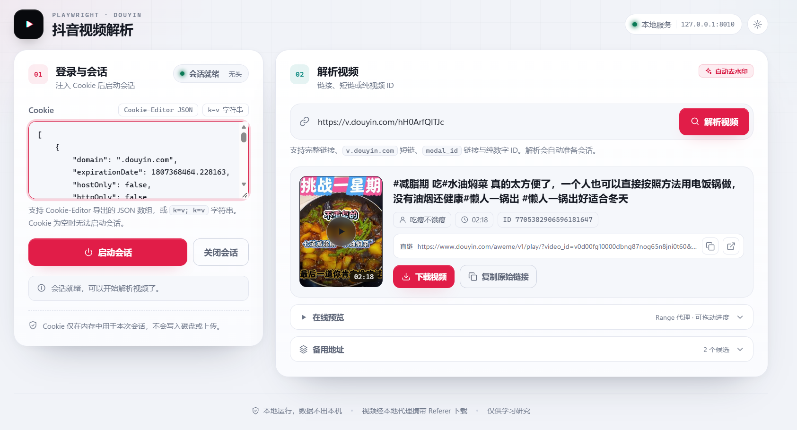

# 抖音视频下载工具

一个运行在本机的抖音视频解析工具：输入抖音**视频链接 / 短链 / 纯视频 ID**，输出视频的**去水印下载直链**，以及标题、作者、封面、时长等基础信息。项目同时提供**命令行**与**本地 Web 界面**两种使用方式。

核心实现提炼自开源项目 [MediaCrawler](https://github.com/NanmiCoder/MediaCrawler) 的抖音模块，只保留「视频信息 + 下载链接 + 本地代理」这一条链路，去掉了评论、创作者主页、搜索、数据库存储等能力。

> **重要：本项目是个人本地自用工具，没有任何鉴权，请只在本机运行，不要部署到公网。**
> 抖音视频详情接口目前要求登录，使用前需要提供你自己的已登录 Cookie。Cookie 等同账号凭据，请勿泄露。

---


## 目录

- [工作原理](#工作原理)
- [项目依赖](#项目依赖)
- [安装](#安装)
- [准备 Cookie](#准备-cookie)
- [Web 界面](#web-界面)
- [命令行使用](#命令行使用)
- [项目结构](#项目结构)
- [开源协议与致谢](#开源协议与致谢)

---


## 工作原理

```text
用户输入：完整链接 / 短链 / modal_id / 纯 ID
   │
   │  1. 解析 aweme_id（短链先跟随 302 跳转）
   ▼
Playwright 启动 Chromium
   │  2. 注入 stealth.min.js 反检测脚本
   │  3. 注入用户 Cookie（必须）
   │  4. 打开目标视频页预热，读取 localStorage.xmst / User-Agent / Cookie
   ▼
DouYinClient 组装请求
   │  5. 公共参数 + webid + msToken + uifid + verifyFp/fp
   │  6. 用 libs/douyin.js 生成 a_bogus 签名（PyExecJS 调用，依赖 Node.js）
   ▼
GET https://www.douyin.com/aweme/v1/web/aweme/detail/
   │  7. 拿到 aweme_detail
   ▼
提取结果
   │  8. play_addr_h264 → play_addr_256 → play_addr → bit_rate（按码率降序）
   │  9. playwm → play（去水印）
   ▼
命令行输出 JSON / Web 界面展示
   │ 10. 下载与预览统一经本地代理（带 Referer、跟随 302、透传 Range）
```

关键「反爬」参数说明：

| 参数 | 说明 |
| --- | --- |
| `a_bogus` | 抖音 Web 接口的签名参数，由 `libs/douyin.js` 逆向实现，通过 PyExecJS 调用 |
| `x-tt-argus` / `uifid` | 抖音边缘网关 ArgusSecurityPlugin 要求的请求头 |
| `uifid` + `verifyFp` / `fp` | detail 接口要求成套出现，后两者取自 `s_v_web_id` Cookie |
| `msToken` / `webid` | 优先取页面写入的 `localStorage.xmst`，缺失时随机生成 |

> **说明：** 上述机制来自上游参考实现。抖音风控策略可能随时变化，若签名失效，需要同步更新 `libs/douyin.js`。


## 项目依赖

### 运行环境

| 依赖 | 版本 / 要求 | 用途 |
| --- | --- | --- |
| Python | **3.12+** | 运行全部代码 |
| Node.js | 建议 LTS（如 18 / 20 / 22） | PyExecJS 执行 `libs/douyin.js` 生成 `a_bogus` |
| Playwright Chromium | 随 Playwright 安装 | 启动浏览器、注入 Cookie、预热取 msToken |
| 操作系统 | Windows / macOS / Linux | 本项目主要在 Windows 下开发验证 |

### 前端与内置脚本

- 前端为原生 **HTML / CSS / JavaScript**，无需 Node.js 构建步骤。
- `libs/douyin.js`：`a_bogus` 签名脚本，来自 MediaCrawler。
- `libs/stealth.min.js`：浏览器反检测脚本，来自 MediaCrawler / `puppeteer-extra-plugin-stealth`。
- 这两个文件属于第三方代码，请遵守其上游许可（见[开源协议与致谢](#开源协议与致谢)）。

## 安装

### 使用 uv（推荐）

```bash
# 安装 uv（如已安装可跳过）：https://docs.astral.sh/uv/
# Windows PowerShell:
#   powershell -ExecutionPolicy ByPass -c "irm https://astral.sh/uv/install.ps1 | iex"

git clone https://github.com/positiveJobs/downloadDouyinVideo.git
cd downloadDouyinVideo

uv sync                             # 按 uv.lock 安装 Python 依赖
uv run playwright install chromium  # 首次需要，安装浏览器内核
```

### 配置环境变量

```bash
# Windows
copy .env.example .env

# macOS / Linux
cp .env.example .env
```

### 检查 Node.js 环境

```bash
node --version
```


## 准备 Cookie

具体步骤可以参考文件: [Cookie-Editor 提取 cookies 教程](./assets/Cookie-Editor 提取 cookies 教程.md)

抖音的视频详情接口对匿名请求强制登录：响应头 `x-whale-throughput-abort-data` 会解码出 `CUSTOM_强登_模型`，并返回空响应。因此**必须提供已登录账号的 Cookie**。

1. 用 Chrome 登录 <https://www.douyin.com>。
2. 安装浏览器插件 **Cookie-Editor**，在抖音页面点击插件 → **Export** → **JSON**，复制整段内容。
   - 也可以按 `F12` → **Application / 应用** → **Cookies** → `https://www.douyin.com`，手动拼出 `k1=v1; k2=v2` 字符串。
3. 将 Cookie 交给命令行（`--cookies` / `DOUYIN_COOKIES`）或 Web 页面。

支持的格式：

```text
# 1) Cookie-Editor 导出的 JSON 数组
[
  {"name": "sessionid", "value": "...", "domain": ".douyin.com", "path": "/"},
  {"name": "ttwid",    "value": "...", "domain": ".douyin.com", "path": "/"}
]

# 2) 字符串形式
sessionid=...; ttwid=...; s_v_web_id=...
```

> **安全提示：** Cookie 只保存在服务端内存中，关闭会话或重启服务即释放；但任何能访问该服务的人都能使用你的 Cookie。**不要提交到 Git、不要贴到截图或日志里。**


## Web 界面

### 启动

```bash
uv sync
uv run uvicorn server.app:app --host 127.0.0.1 --port 8010
```

Windows 也可以直接双击 `start_web.bat`（会自动执行 `uv sync` 并启动服务）。

浏览器打开 <http://127.0.0.1:8010>。




### 使用流程

1. 在左侧「登录与会话」粘贴 Cookie（Cookie-Editor JSON 或 `k=v; k=v` 字符串）。
2. 点击 **启动会话**，等待状态变为「会话就绪」。
3. 在右侧输入视频链接 / 短链 / ID，点击 **解析视频**。
4. 结果卡片支持：
   - **复制直链**；
   - **下载视频**（走 `/api/download` 代理，带 Referer）；
   - **在线预览**（走 `/api/stream` 代理，透传 Range，可拖动进度）；
   - **备用地址**（候选 CDN 地址列表）。

> 小提示：Cookie 为空时无法启动会话，页面会弹出提示。修改 Cookie 后再次点击「解析视频」会自动重启会话。


## 命令行使用

```bash
# 设置环境变量读取 Cookie（Windows CMD）
set DOUYIN_COOKIES=sessionid=xxx; ttwid=xxx

# PowerShell
$env:DOUYIN_COOKIES = "sessionid=xxx; ttwid=xxx"

# macOS / Linux
export DOUYIN_COOKIES="sessionid=xxx; ttwid=xxx"

# 完整链接
uv run main.py https://www.douyin.com/video/7525082444551310602

# 纯视频 aweme_id
uv run main.py 7525082444551310602

# 短链
uv run main.py https://v.douyin.com/xxxxxxx/

# 带 modal_id 的链接
uv run main.py "https://www.douyin.com/user/xxx?modal_id=7525082444551310602"

```

无头 / 有头默认由 `.env` 中的 `HEADLESS` 决定：`true`（默认）为无头，`false` 为有头。

### 输出示例

```json
{
  "aweme_id": "7525082444551310602",
  "title": "视频标题",
  "author": "作者昵称",
  "cover": "https://.../cover.jpg",
  "duration_ms": 15000,
  "video_url": "https://.../play/?video_id=...",
  "video_urls": [
    "https://.../play/?video_id=...",
    "https://.../play/?video_id=...&ratio=..."
  ]
}
```

| 字段 | 说明 |
| --- | --- |
| `aweme_id` | 视频 ID |
| `title` | 视频文案 / 标题 |
| `author` | 作者昵称 |
| `cover` | 封面图地址 |
| `duration_ms` | 视频时长（毫秒） |
| `video_url` | 主下载地址（已去水印） |
| `video_urls` | 按清晰度优先级排列的全部候选地址 |


## 项目结构

```text
.
├── main.py                  # 命令行入口
├── config.py                # 加载 .env，解析 HEADLESS
├── pyproject.toml           # 依赖声明
├── uv.lock                  # 锁定依赖版本
├── Dockerfile               # 镜像构建（Node.js + uv + Chromium）
├── .env.example             # 环境变量示例
├── start_web.bat            # Windows 一键启动 Web 服务
├── douyin/
│   ├── __init__.py
│   ├── parser.py            # 链接 / 短链 / ID → aweme_id（含跳转白名单）
│   ├── crawler.py           # Chromium 生命周期、stealth、Cookie 注入、预热
│   ├── client.py            # 公共参数组装、a_bogus 签名、detail 接口请求
│   ├── signer.py            # PyExecJS 调用 douyin.js；webid / msToken 生成
│   ├── cookie_utils.py      # Cookie-Editor JSON / 字符串 Cookie 解析
│   └── extractor.py         # aweme_detail → 下载地址、封面、标题、作者
├── server/
│   ├── app.py               # FastAPI 路由、会话、下载 / 预览代理
│   ├── session.py           # 单会话状态机与浏览器生命周期
│   ├── schemas.py           # 请求模型
│   └── static/              # 生产前端（index.html / style.css / app.js）
├── libs/
    ├── douyin.js            # a_bogus 签名脚本（第三方）
    └── stealth.min.js       # 反检测脚本（第三方）
```


## 开源协议与致谢

- `libs/douyin.js`、`libs/stealth.min.js` 及整体实现思路来自 [MediaCrawler](https://github.com/NanmiCoder/MediaCrawler)，请一并遵守其上游许可与使用条款。
- 感谢 [Playwright](https://playwright.dev/)、[FastAPI](https://fastapi.tiangolo.com/)、[httpx](https://www.python-httpx.org/)、[PyExecJS](https://github.com/doloopwhile/PyExecJS) 等开源项目。

---

如果这个项目对你有帮助，欢迎 Star ⭐ 与提交 Issue / PR。
